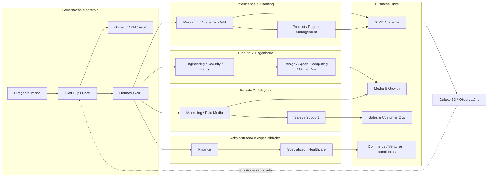
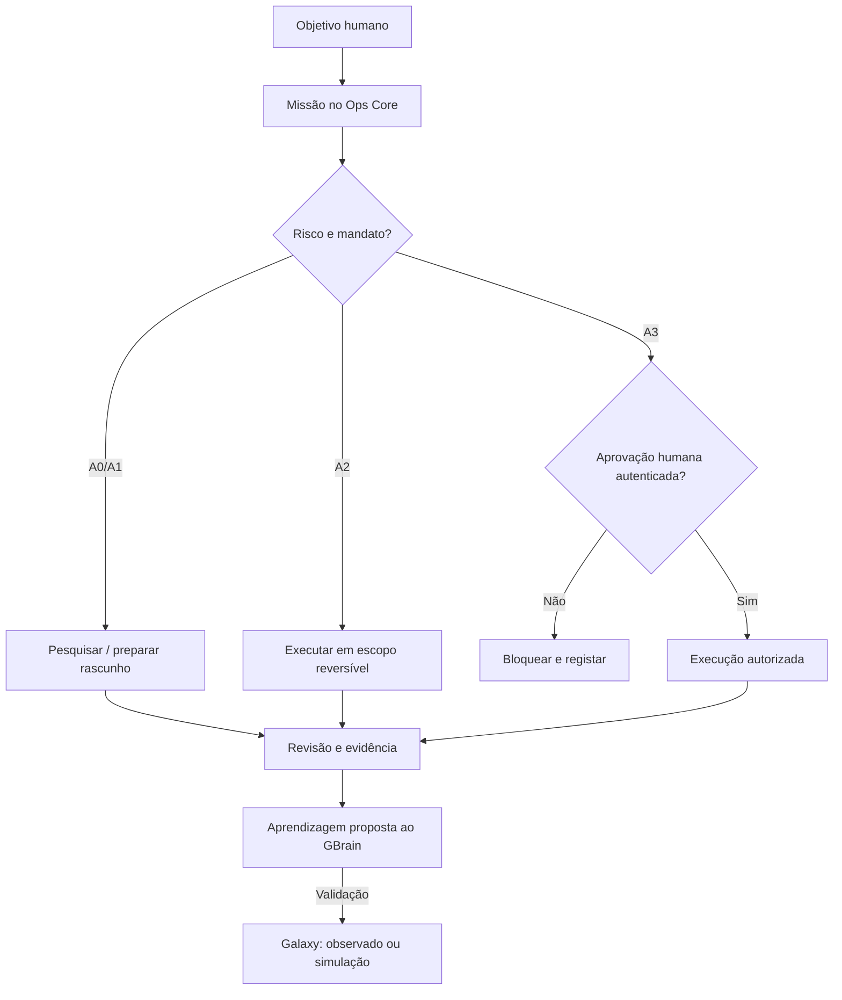

# Mapa experimental GWD — Divisões, fluxos e núcleos

**Experimental · V0.1 · 07/11/2026 · Não representa agentes em produção.**

A [Agency Agents](https://github.com/msitarzewski/agency-agents) reúne mais de 230 perfis e 18 divisões documentais na versão consultada. A GWD usará estas divisões como **ontologia de capacidades**, não como lista de agentes ativos. Para executar, cada perfil precisa de um dono humano, manifesto, ferramentas permitidas, versão, teste e aprovação A0–A3.

## Mapa de fluxos e funções

> Este fluxograma é uma **proposta de modelação**, com divisões do Agency Agents agrupadas por afinidade. Não declara competência, acesso, contratação ou execução homologadas.

## Matriz de 18 divisões

| Divisão upstream | Função candidata GWD | Primeiro ensaio |
|---|---|---|
| Academic | Pesquisa e formação | Estrutura de uma aula validada |
| Design | Criativos e experiência | Brief e design QA |
| Engineering | Backend e integrações | API fake e testes |
| Finance | Custos e controlo | Simulação de orçamento |
| Game Development | Gamificação | Protótipo sem utilizadores reais |
| GIS | Análises geoespaciais | Amostra sintética |
| Healthcare | Pesquisa setorial regulada | Documento informativo revisado |
| Marketing | Planeamento comercial | Brief e campanha simulada |
| Paid Media | Anúncios | Rascunho sem publicação ou gasto |
| Product | Propostas de produto | Product brief e critérios de aceite |
| Project Management | Missões e processos | Plano e matriz de riscos |
| Research | Intelligence & fontes | Pesquisa com proveniência |
| Sales | Comercial | Proposta de serviço aprovada |
| Security | Política e isolamento | Teste negativo de acesso |
| Spatial Computing | Galaxy 3D | Constelação sintética |
| Specialized | Especialistas setoriais | Avaliação de domínio |
| Support | Atendimento | Triagem de ticket sintético |
| Testing | Qualidade independente | Regressão e conformidade |

## Fluxo canónico de uma experiência

## Regras de observação

- `CATALOG_CANDIDATE` não equivale a instância ativa.
- `PROPOSED` descreve um papel sem credenciais.
- `TESTING` implica ambiente isolado e dados sintéticos.
- `ACTIVE` exige parecer técnico, aprovação humana e auditoria.
- `RETIRED` significa capacidade descontinuada ou desautorizada.

Os agentes de um cliente não consultam memória ou dados de outro cliente por padrão. A visualização pública receberá só projeções agregadas e aprovadas.

## Da visão à execução

O primeiro caso experimental é **Revenue Now**: Diana coordena o plano, Tomás pesquisa o mercado, Elisa estrutura a oferta e Maia apoia a audiência — com aprovação humana antes de publicação externa, contrato ou despesa. O laboratório medirá custos, qualidade, conversões e entregas reais quando estes dados existirem.
