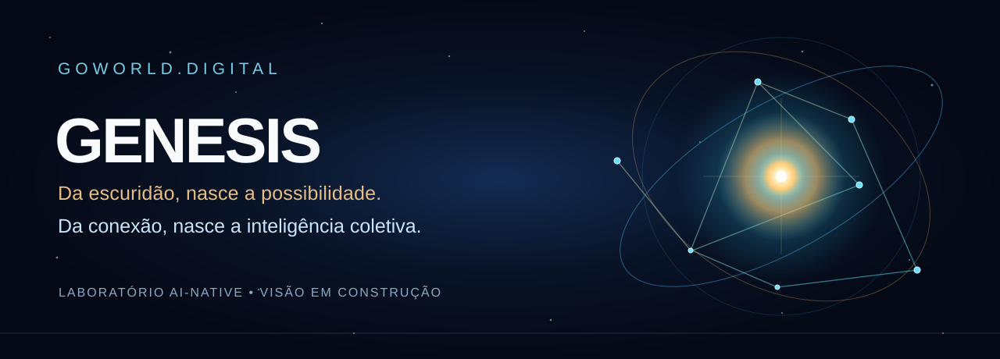
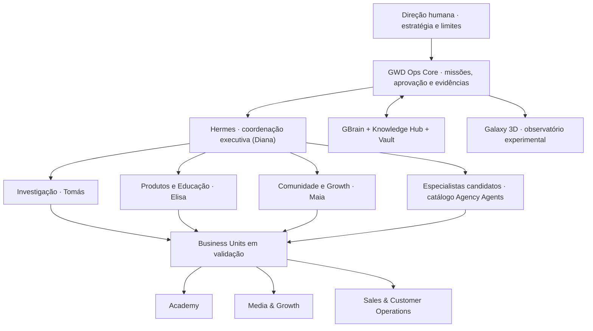

  

  <strong>Build the future. Observe it being born.</strong> 
  <em>Uma organização AI-Native em construção aberta à investigação, à aprendizagem e à crítica.</em>

---

## GENESIS — Antes da luz, existia a possibilidade

No princípio, imaginemos a escuridão. Não uma ausência de futuro, mas um universo de possibilidades ainda sem forma — sem ligações, sem papéis definidos, sem memória partilhada.

Então, o primeiro evento: **uma intenção**. Uma ideia encontra outra. Um conhecimento encontra um problema. Uma pessoa encontra um agente. Uma missão dá origem a relações, decisões, experiências e aprendizagem.

Não é uma recriação científica do Big Bang: é **uma metáfora para o nascimento de uma organização**.

Tal como uma constelação só se torna reconhecível quando conseguimos observar as relações entre as estrelas, acreditamos que uma organização AI-Native se revela quando pessoas, agentes, conhecimento e sistemas começam a operar em conjunto, com responsabilidade, evidências e memória.

**O nosso GENESIS é essa experiência. Não anunciamos uma superinteligência já existente; estamos a investigar como construir sistemas de inteligência coordenada que possam ser úteis, transparentes e governáveis.**

> **Do caos à coordenação. Das primeiras ligações à inteligência coletiva. Da hipótese à evidência.**

## Três universos, fronteiras claras

| Ecossistema | Missão |
|---|---|
| **GoWorld.Digital (GWD)** | Empresa-piloto AI-Native: desenvolver ofertas reais, operações, Business Units e aprendizagem baseada em resultados |
| **AtlasHub** | Engenharia e tecnologia que podem servir a GWD por interfaces e contratos identificados |
| **AtlasClub / GENESIS** | Comunidade, aprendizagem, investigação e observação crítica do laboratório; não é uma sociedade independente |

### Como a experiência se organiza

Esta é uma **arquitetura-alvo**, não um organigrama de colaboradores contratados nem um painel de agentes comprovadamente ativos. O [mapa experimental](../docs/EXPERIMENTAL-AGENT-MAP.md) aprofunda 18 divisões de capacidades, futuras Business Units e níveis de homologação.

## O que estamos a testar

**Uma hipótese operacional:** uma empresa pode coordenar pessoas e agentes de IA para pesquisar, criar, prestar serviços, medir custos, rever decisões e aprender — desde que separe funções, memória, autorização e responsabilidade.

A GWD começa com um **Clean Room operacional**: identidade, dados, memória e agentes próprios; tecnologia existente só pode ser incorporada mediante análise, rastreabilidade e testes. O GWD Ops Core governa as missões, o Hermes executa, o GBrain apoia a memória institucional e a Galaxy 3D poderá mostrar o que é apenas simulado versus o que foi realmente observado.

### O que existe — e o que ainda não existe

| Estado | Significado |
|---|---|
| **IDEIA** | Proposta de investigação ou unidade futura |
| **PROPOSTO** | Mandato, perfil ou arquitetura documentados |
| **EM TESTES** | Execução controlada com dados sintéticos ou escopo restrito |
| **HOMOLOGADO** | Critérios técnicos e humanos de autorização satisfeitos |
| **OBSERVADO** | Resultado suportado por evidências acessíveis e verificáveis |

Sem promessas de autonomia total, faturação comprovada ou participação financeira. GENESIS não concede, por si só, emprego, privilégios, quotas ou direitos de investimento. Qualquer colaboração comercial ou societária depende de acordos próprios.

---

  <strong>O futuro não é uma demo. É uma sequência de experiências que resistem à verificação.</strong>

  <a href="https://github.com/GoWorld-Digital">Organização GitHub</a> · <a href="../docs/GENESIS-MANIFESTO-V0.md">Manifesto experimental</a>

Perfil público v0.1 — visão em desenvolvimento. Ilustração e fluxos conceptuais; sem representação de telemetria operacional.
